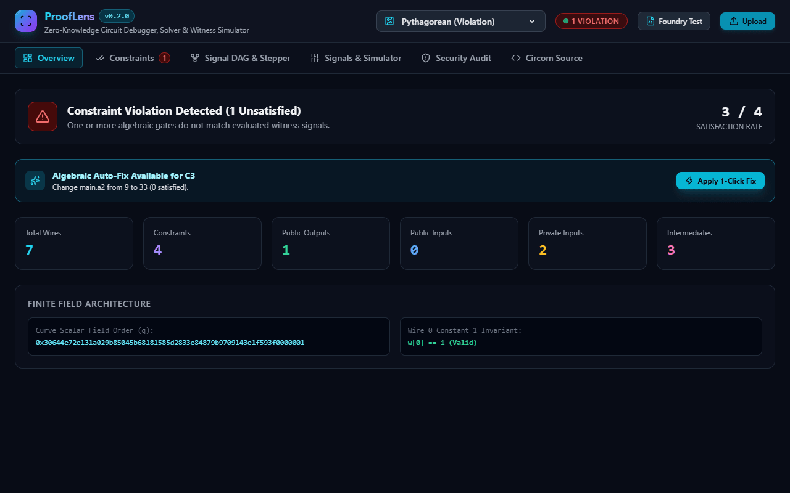
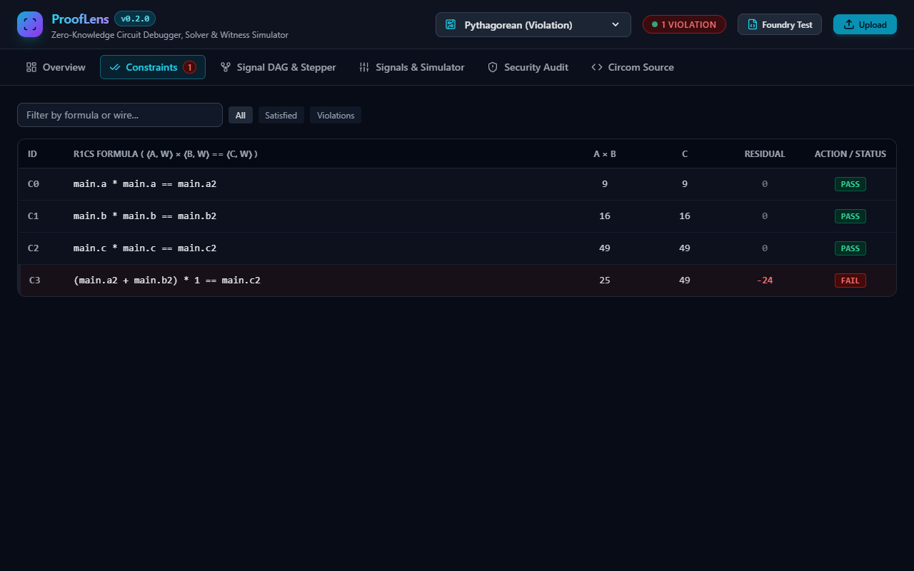
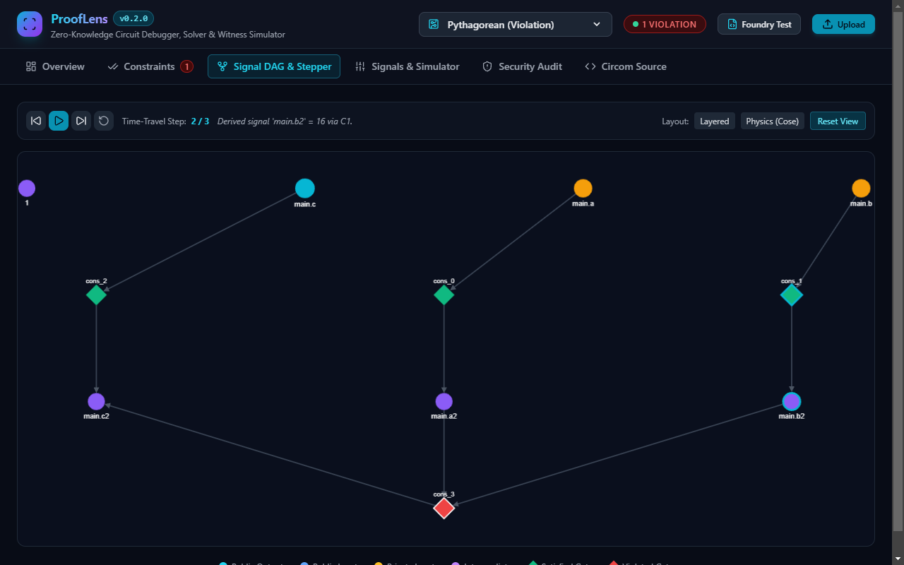
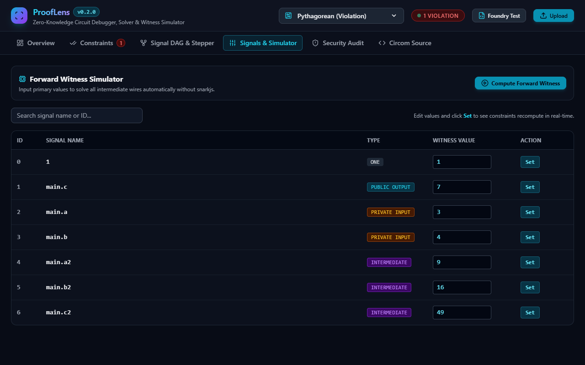

<p align="center">
  
</p>

<h1 align="center">ProofLens</h1>

<p align="center">
  <strong>Interactive Zero-Knowledge Proof Circuit Debugger, R1CS Constraint Visualizer, and Witness Inspector</strong>
</p>

<p align="center">
  <a href="https://github.com/alexandrmotologa/prooflens/actions"></a>
  <a href="https://github.com/alexandrmotologa/prooflens/blob/main/LICENSE"></a>
  <a href="https://python.org"></a>
</p>

ProofLens is an inspection and debugging workbench for Zero-Knowledge Proof (ZKP) circuits. It reads binary R1CS constraint systems and witness vectors compiled by Circom and snarkjs, evaluates mathematical satisfaction over the BN254 scalar field, isolates failing constraints, and generates interactive dependency DAGs to trace signal propagation.

<p align="center">
  
</p>

---

## Capabilities

- **BN254 Scalar Field Engine**: Native 254-bit modular arithmetic over the alt_bn128 prime order ($q = 21888242871839275222246405745257275088548364400416034343698204186575808495617$) with support for signed signal representations.
- **Binary R1CS Parser & Writer**: Parses iden3 Circom R1CS format v1 without external C bindings, supporting sparse linear combinations and multi-section chunks.
- **Witness Inspection (WTNS & JSON)**: Reads binary `.wtns` files and JSON witness arrays, binding signal values to named circuit symbols from `.sym` symbol tables.
- **Constraint Solver & Fault Isolation**: Identifies violated constraints ($(A \cdot w) \times (B \cdot w) \neq C \cdot w$), computes non-zero residuals, and highlights candidate unassigned or corrupted signals.
- **DAG Signal Flow Visualization**: Constructs a directed acyclic graph mapping inputs, intermediate signals, and output constraints to expose variable dependencies.
- **Security & Under-Constrained Audit**: Flags signals unconstrained by linear equations or intermediate variables subject to witness malleability.
- **Interactive Web Studio & Rich CLI**: Inspect circuits from a terminal dashboard using Typer and Rich, or launch the FastAPI Web Studio with real-time constraint manipulation and graph exploration.

---

## Architecture

```
                  +--------------------------+
                  |  Circom Compiler (.r1cs) |
                  |  Witness Calc (.wtns)    |
                  |  Symbol Map (.sym)       |
                  +-------------+------------+
                                |
                                v
               +--------------------------------+
               |     ProofLens Core Ingestion   |
               | - BN254 Finite Field Engine    |
               | - Binary R1CS Parser           |
               | - WTNS / JSON Witness Loader   |
               +----------------+---------------+
                                |
             +------------------+------------------+
             |                                     |
             v                                     v
+------------------------+             +------------------------+
|   Constraint Evaluator |             | Signal Flow DAG Engine |
| - Satisfaction check   |             | - Topological sort     |
| - Residual computation |             | - Provenance tracing   |
| - Under-constraint scan|             | - Cytoscape / Web view |
+------------+-----------+             +-----------+------------+
             |                                     |
             +------------------+------------------+
                                |
                                v
               +--------------------------------+
               |       Presentation Layer       |
               | - Typer / Rich Terminal UI     |
               | - FastAPI Interactive Studio   |
               +--------------------------------+
```

---

## Installation

```bash
git clone https://github.com/alexandrmotologa/prooflens.git
cd prooflens
python -m venv .venv
source .venv/bin/activate  # On Windows: .venv\Scripts\activate
pip install -e ".[dev]"
```

---

## Command Line Interface

### 1. Inspect Circuit Metrics

```bash
prooflens inspect examples/pythagorean.r1cs --sym examples/pythagorean.sym
```

Output:
```
+-------------- ProofLens Circuit Inspection: pythagorean.r1cs ---------------+
|                      Circuit Header & Metric Overview                       |
| +-------------------------------------------------------------------------+ |
| | Metric                | Value                                           | |
| |-----------------------+-------------------------------------------------| |
| | Total Wires (Signals) | 7                                               | |
| | Total Constraints     | 4                                               | |
| | Public Outputs        | 1                                               | |
| | Public Inputs         | 0                                               | |
| | Private Inputs        | 2                                               | |
| | Intermediate Wires    | 3                                               | |
| | Field Size (Bytes)    | 32                                              | |
| | Field Modulus         | 0x30644e72e131a029b85045b68181585d2833e848...   | |
| +-------------------------------------------------------------------------+ |
+-----------------------------------------------------------------------------+
    Constraint Preview (Showing first 4 of 4)     
+------------------------------------------------+
| ID     | Formula ( <A, w> * <B, w> == <C, w> ) |
|--------+---------------------------------------|
| 0      | main.a * main.a == main.a2            |
| 1      | main.b * main.b == main.b2            |
| 2      | main.c * main.c == main.c2            |
| 3      | (main.a2 + main.b2) * 1 == main.c2    |
+------------------------------------------------+
```

### 2. Verify Witness and Highlight Violations

```bash
prooflens check examples/pythagorean.r1cs --witness examples/pythagorean_violation.wtns --sym examples/pythagorean.sym
```

Output:
```
+---------------------------- Verification Result ----------------------------+
| CIRCUIT UNSATISFIED                                                         |
| Satisfied: 3 / 4 constraints                                                |
| Violations: 1 failing constraints                                           |
| Constant 1 wire: Valid                                                      |
+-----------------------------------------------------------------------------+
                          Violation at Constraint C3                           
+-----------------------------------------------------------------------------+
| Property           | Details                                                |
|--------------------+--------------------------------------------------------|
| Formula            | (main.a2 + main.b2) * 1 == main.c2                     |
| A evaluated        | 25                                                     |
| B evaluated        | 1                                                      |
| Product (A * B)    | 25                                                     |
| C evaluated        | 49                                                     |
| Residual (A*B - C) | -24                                                    |
| Culprit Candidates | main.c2 (assigned: 49), main.a2 (assigned: 9), main.b2 |
|                    | (assigned: 16)                                         |
+-----------------------------------------------------------------------------+
```

### 3. Audit for Under-Constrained Signals

```bash
prooflens audit examples/vulnerable.r1cs --sym examples/vulnerable.sym
```

Output:
```
                   Security Audit: Found 3 Potential Issues                    
+-----------------------------------------------------------------------------+
| Severity   | Category             | Signal               | Description      |
|------------+----------------------+----------------------+------------------|
| HIGH       | DEAD_SIGNAL          | main.out             | Signal           |
|            |                      |                      | 'main.out' (ID   |
|            |                      |                      | 1, type          |
|            |                      |                      | public_output)   |
|            |                      |                      | is declared but  |
|            |                      |                      | never referenced |
|            |                      |                      | in any           |
|            |                      |                      | constraint.      |
| HIGH       | UNDER_CONSTRAINED    | main.ratio           | Intermediate     |
|            |                      |                      | signal           |
|            |                      |                      | 'main.ratio' (ID |
|            |                      |                      | 4) appears in    |
|            |                      |                      | only 1           |
|            |                      |                      | constraint. It   |
|            |                      |                      | may be           |
|            |                      |                      | under-constrained|
|            |                      |                      | allowing proof   |
|            |                      |                      | forgery.         |
| MEDIUM     | DEAD_SIGNAL          | main.dead_weight     | Signal           |
|            |                      |                      | 'main.dead_weight|
|            |                      |                      | (ID 5, type      |
|            |                      |                      | intermediate) is |
|            |                      |                      | declared but     |
|            |                      |                      | never referenced |
|            |                      |                      | in any           |
|            |                      |                      | constraint.      |
+-----------------------------------------------------------------------------+
```

### 4. Forward-Evaluate Witness from Raw Inputs

```bash
prooflens compute-witness examples/multiplier.r1cs --inputs examples/multiplier_inputs.json --sym examples/multiplier.sym
```

### 5. Algebraic Witness Auto-Fixer

```bash
prooflens fix examples/multiplier.r1cs --witness examples/multiplier_violation.wtns --sym examples/multiplier.sym
```

### 6. Compare Circuit Revisions (R1CS Diff)

```bash
prooflens diff examples/multiplier.r1cs examples/pythagorean.r1cs --sym-a examples/multiplier.sym --sym-b examples/pythagorean.sym
```

### 7. Scan Bit-Width & Field Wrap-Around

```bash
prooflens scan-bits examples/vulnerable.r1cs --sym examples/vulnerable.sym
```

### 8. Export Solidity & Foundry Test Vectors

```bash
prooflens export-test examples/pythagorean.r1cs --witness examples/pythagorean_satisfied.wtns --sym examples/pythagorean.sym --format foundry
```

### 9. Trace Provenance Dependency Graph

```bash
prooflens trace examples/pythagorean.r1cs --signal main.c2 --sym examples/pythagorean.sym
```

### 10. Launch Interactive Web Studio

```bash
prooflens studio --port 8000
```

---

## Web Studio Views

| Overview & Auto-Fixer | Constraints Inspector |
|---|---|
|  |  |

| Signal DAG & Stepper | Signal Mutator & Simulator |
|---|---|
|  |  |

---

## Test Verification

```bash
pytest -v --cov=prooflens tests/
```

Results:
- 51 passing unit tests
- High test coverage across core arithmetic, R1CS binary parsing, witness solver, DAG engine, and Studio APIs.

---

## License

MIT License. See [LICENSE](LICENSE) for details.
