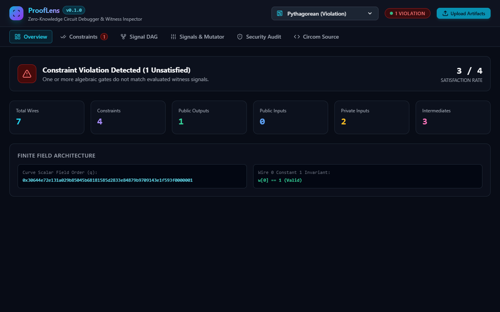

<p align="center">
  
</p>

<h1 align="center">ProofLens</h1>

<p align="center">
  <strong>Interactive Zero-Knowledge Proof Circuit Debugger, R1CS Constraint Visualizer, and Witness Inspector</strong>
</p>

<p align="center">
  <a href="https://github.com/alexandrmotologa/prooflens/actions"></a>
  <a href="https://github.com/alexandrmotologa/prooflens/blob/main/LICENSE"></a>
  <a href="https://python.org"></a>
</p>

ProofLens is a debugging and inspection workbench for Zero-Knowledge Proof (ZKP) circuits. It reads binary R1CS constraint systems and witness vectors compiled by Circom, evaluates mathematical satisfaction over the BN254 scalar field, isolates failing constraints, and generates interactive dependency DAGs to trace signal propagation.

---

## Capabilities

- **BN254 Scalar Field Engine**: Native 254-bit modular arithmetic over the alt_bn128 prime order ($q = 21888242871839275222246405745257275088548364400416034343698204186575808495617$) with support for signed signal representations.
- **Binary R1CS Parser & Writer**: Parses iden3 Circom R1CS format v1 without external dependencies, supporting sparse linear combinations and multi-section chunks.
- **Witness Inspection (WTNS & JSON)**: Reads binary `.wtns` files and JSON witness arrays, binding signal values to named circuit symbols from `.sym` symbol tables.
- **Constraint Solver & Fault Isolation**: Identifies violated constraints ($(A \cdot w) \times (B \cdot w) \neq C \cdot w$), computes non-zero residuals, and highlights candidate unassigned or corrupted signals.
- **DAG Signal Flow Visualization**: Constructs a directed acyclic graph mapping inputs, intermediate signals, and output constraints to expose variable dependencies.
- **Security & Under-Constrained Audit**: Flags signals unconstrained by linear equations or intermediate variables subject to witness malleability.
- **Interactive Web Studio & Rich CLI**: Inspect circuits from a terminal dashboard using Typer and Rich, or launch the FastAPI Web Studio with real-time constraint manipulation and graph exploration.

---

## Architecture

```
                  +--------------------------+
                  |  Circom Compiler (.r1cs) |
                  |  Witness Calc (.wtns)    |
                  |  Symbol Map (.sym)       |
                  +-------------+------------+
                                |
                                v
               +--------------------------------+
               |     ProofLens Core Ingestion   |
               | - BN254 Finite Field Engine    |
               | - Binary R1CS Parser           |
               | - WTNS / JSON Witness Loader   |
               +----------------+---------------+
                                |
             +------------------+------------------+
             |                                     |
             v                                     v
+------------------------+             +------------------------+
|   Constraint Evaluator |             | Signal Flow DAG Engine |
| - Satisfaction check   |             | - Topological sort     |
| - Residual computation |             | - Provenance tracing   |
| - Under-constraint scan|             | - Cytoscape / Web view |
+------------+-----------+             +-----------+------------+
             |                                     |
             +------------------+------------------+
                                |
                                v
               +--------------------------------+
               |       Presentation Layer       |
               | - Typer / Rich Terminal UI     |
               | - FastAPI Interactive Studio   |
               +--------------------------------+
```

---

## Installation

```bash
git clone https://github.com/alexandrmotologa/prooflens.git
cd prooflens
python -m venv .venv
source .venv/bin/activate  # On Windows: .venv\Scripts\activate
pip install -e ".[dev]"
```

---

## Quick Start

### 1. Inspect Circuit Metrics

```bash
prooflens inspect circuit.r1cs
```

### 2. Verify Witness and Highlight Violations

```bash
prooflens check circuit.r1cs --witness witness.wtns --sym circuit.sym
```

### 3. Audit for Under-Constrained Signals

```bash
prooflens audit circuit.r1cs
```

### 4. Launch Interactive Web Studio

```bash
prooflens studio --port 8000
```

---

## Visual Studio Preview



---

## Verification & Tests

```bash
pytest -v --cov=prooflens tests/
```

---

## License

MIT License. See [LICENSE](LICENSE) for details.
